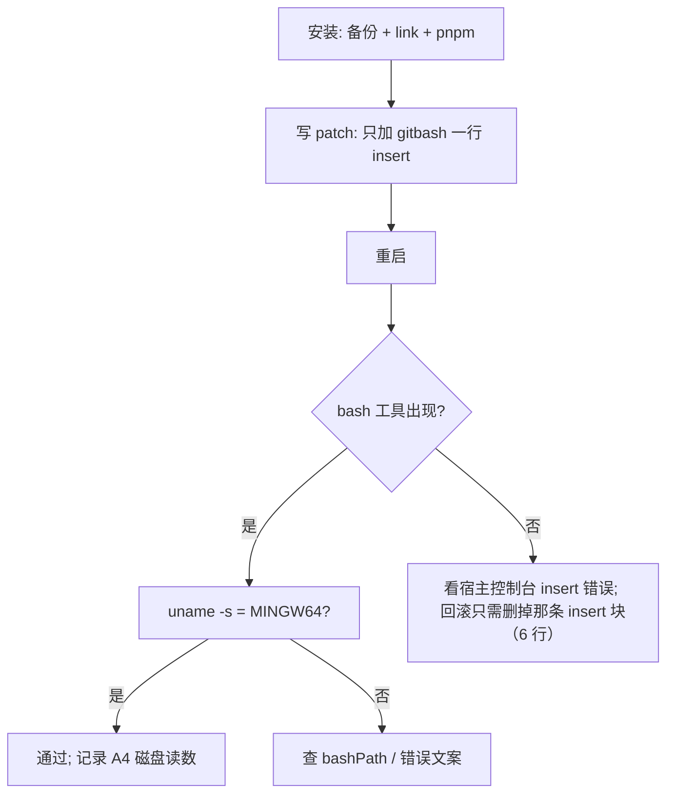

# dsh-gitbash 设计档（v2.1：并行 bash 工具 + 宿主沙箱；现行版本 0.2.0）

> 本文是**机制与设计**的单一权威源；**安装步骤**的唯一权威源是 `docs/install.md`。

## 背景

`dsh-ops`（第三方插件，0.5.0）在 Windows 上用自带 "niubash" 运行时提供 bash。实测每次
`ops_bash` 调用都会 `mkdtemp` 后 `fs.cp` 整棵运行时再删除：单次落盘 786 MB / 313 文件
（其中 705 MB 是同一个 `winuxcmd.exe` 复制 153 份），单次 `echo hi` 12.99 秒，同一时刻可观测
6 份副本 ≈ 4.7 GB。（以上均为 2026-11-11 本机实测 as-of。）用户已停用该插件，并要求：**直接接本机 Git Bash，不拷贝、不产生临时运行时**（用户 2026-11-11 直接指令；本批无独立需求档，需求以该指令为准）。

v0.2.0（2026-11-12）把执行路径接回宿主沙箱：每次调用经 `ctx.sandboxPolicy` 解析策略、经 `ctx.sandbox.confine()` 得到受限 argv；需求、决策、测试矩阵与真机验收见 `docs/v0.2-design.md`。

## 问题

1. dsh 在 Windows 上默认只有 `pwsh`：base bundle 用平台表达式关掉 bash 行
   （`app.asar:/dsh/node_modules/@deepseek-ai/dsh-base/cordis.patch.yml:249-287`，as-of 2026-11-11 / DSH 0.2.2-rc.1）。
2. `ctx.shell` 是单实现 seam（`@deepseek-ai/dsh-shell/lib/index.js:55-60`）。
3. **v1 设计（替换 ctx.shell）在真机失败**，原因有两条实测证据：
   - 停用 `pwsh-sandbox` 会让内置预设装配失败 → 会话冷恢复报 `UnknownPresetError`、界面显示「会话不可用」
     （2026-11-11 13:55 另一会话在 profile 内的实测记录）；
   - **修正（2026-11-11 15:0x）**：v1 的行其实**从未进入 insert 列表**——它被写成顶层 `- id: gitbash`，
     而顶层条目是「按 id 覆盖既有行」，对不存在的 id 是静默空操作。所以 v1 的失败首因是**语法**，
     「duplicate service」只是当时的推断、并未被实测证实；上面那条 preset/pwsh 约束是**独立**成立的证据。
     现象佐证：重启后 `probe-baseline.txt` 不存在、`bash` 工具实际执行的是 PowerShell。

结论：**不能动 `ctx.shell`**。要 bash，只能另加一个平行工具。

## 目标

- 一个名为 `bash` 的工具，直接 spawn 本机 `bash.exe`；不拷贝、不解包、不建运行时副本。
- 与 pwsh **共存**：不注册任何 service，不改其他行，最坏情况只是本工具不出现。
- 输出语义与官方 shell 工具一致（stdout → `[stderr]` 段 → 标记行）。
- 失败显式：命令本身空、可执行文件不存在、subprocess 服务缺失，都返回可读文案而不是抛异常。
- **执行路径接入宿主沙箱（v0.2.0）**：复用 `ctx.sandboxPolicy` / `ctx.sandbox` seam；沙箱不可用一律 fail closed（见 FR-6）。

**非目标**：不替换 pwsh；不实现自研沙箱（v0.2.0 复用宿主 seam；Windows 只限写，见「边界」），也不做读/网络隔离；不提供 ops_* 式文件工具。

## 决策与理由

| 决策 | 选择 | 理由 | 被否决的方案 |
|---|---|---|---|
| 注册形态 | 普通插件 + `ctx.tools.register` 纯对象定义 | 不 import 任何 `@deepseek-ai/*`，零解析风险（dsh-ops 同款做法） | 继承 `SandboxBashExecutor`：需要 import 且会抢 `ctx.shell` |
| 与 pwsh 的关系 | 平行共存 | `ctx.shell` 单实现 + preset 依赖 pwsh | 替换：v1 已真机失败 |
| 执行时机 | 前台同步 | 与官方 bash 工具一致；后台作业属 jobs 服务，另批再说 | 自带 job 管理：重复造轮子 |
| 测试策略 | 注入 `spawn`，用 node:child_process 适配器 | 不依赖 DSH 进程即可端到端验证 | 只做纯函数单测：覆盖不到真实 spawn/render |
| 沙箱接入（v0.2.0） | 复用宿主 `ctx.sandbox` / `ctx.sandboxPolicy` seam | 与官方 bash/pwsh 同源；宿主升级自动跟随；零新依赖 | 自研 ACL / Job 运行器（重复实现、必漂移） |
| 缺沙箱服务（v0.2.0） | 默认 fail closed；仅 `unconfinedWhenSandboxMissing: true` 放行「无策略服务」一种情形 | 安全默认；provider 缺失 / policy 非法一律拒绝 | 静默降级（不安全的默认） |
| 结果分类（v0.2.0） | 插件内复刻 `matchesSignature` / `classifyRunnerFailure` | 遵守零 `@deepseek-ai` 值导入 | 直接 import（profile 插件解析不到宿主包） |

## 方案

**FR-1 工具定义**：`apply(ctx, config)` 注册一个纯对象工具
`{ name: "bash", description, parameters, output: {schema:{type:"string"}, render}, execute }`。
**FR-1a 服务注入**：插件必须 `export const inject = ["tools"]`，否则 cordis 不把 `ctx.tools` 挂到 ctx 上，
`apply()` 在注册处抛错而整行加载失败（v2 首次挂载真机失败即此因，2026-11-11 实测）。
**FR-2 路径解析**（`lib/resolve.js`，本档自含）：候选顺序严格为 ① 配置 `bashPath` → ② `DSH_GITBASH_PATH` → ③ `DSH_GITBASH_ROOT\bin\bash.exe` → ④ `GIT_INSTALL_ROOT\bin\bash.exe` → ⑤ `%ProgramW6432%`/`%ProgramFiles%`/`%ProgramFiles(x86)%` 下的 `Git\bin\bash.exe` → ⑥ `%LOCALAPPDATA%\Programs\Git\bin\bash.exe` → ⑦ `PATH` 各目录。两条判定：**声明但无效 ⇒ 抛 `GITBASH_UNAVAILABLE`，不咨询候选、不回退**；**未声明 ⇒ 走 ②–⑦，PATH 是最后一档**。单测见 `test/candidate.test.mjs`（8 例）。v0.1.0 发布时删除了 v2 里的两个作者本机便利项（私有 Git 安装目录）与 `PROBE_MARKER`，发行版不含作者本机路径。
**FR-3 执行**：`ctx.get('subprocess').spawn({ argv: [bash,'--noprofile','--norc','-c',command], cwd, stdio, graceMs, signal, env })`，
等待 `handle.done`，用 `handle.collected.{stdout,stderr}.readFrom(0)` 取输出。
**FR-4 装载**：profile 的 `cordis.patch.yml` 里必须以 `- insert:` 列表项承载本行（顶层 `- id:` 只能覆盖既有行）；
`- insert:` 缩进 4 空格再写 `- id: gitbash`。
**FR-5 渲染**：`renderResult` → stdout + `[stderr]` 段 + 标记行；v0.2.0 起沙箱标记排在最前，再是 `[timed out after Nms]` / `[error: ...]` / `[signal: ...]` / `[exit code: N]`。

**FR-6 沙箱执行（v0.2.0）**：`execute()` 在 spawn 之前解析宿主策略——`ctx.get('sandboxPolicy').resolve(exec.agent ? { session: exec.agent.session } : {})`。
策略合法（对象且 `mode` ∈ `read-only` / `workspace-write` / `danger-full-access`）且非 `danger-full-access` 时，`ctx.get('sandbox')` 必须存在，
argv 经 `sandbox.confine([bash,'--noprofile','--norc','-c',command], policy, exec.signal)` 得到，且**只 spawn `prepared.argv`**。
沙箱服务的任何异常或畸形返回都在 spawn 之前失败（`SANDBOX_UNAVAILABLE: …`；宿主错误码 `SANDBOX_UNSUPPORTED_POLICY` / `SANDBOX_INVALID_ROOT` 优先保留）。
策略服务缺失时默认拒绝；唯一例外是 `unconfinedWhenSandboxMissing: true`（退回 FR-3 的原 argv）。denial / runner 失败标记与宿主逐字一致；受限模式下 runner 可执行文件启动失败（ENOENT/EACCES）另按 `SANDBOX_UNAVAILABLE: … the command did not run …` 返回，不追加 denial 标记（T14 锚定；`danger-full-access` 的既有错误文案不变）。
完整规则、测试矩阵与真机验收见 `docs/v0.2-design.md`。

### 受影响文件

| 文件 | 状态 | 作用 |
|---|---|---|
| `lib/index.js` | **v2 重写；v0.2.0 接入沙箱** | 插件入口：`apply`/`execute`/`runArgv`/`renderResult` + 策略解析与沙箱结果分类 |
| `lib/resolve.js` | v1 复用（发布清理） | 纯路径解析核心（不 import `@deepseek-ai/*`）；v0.1.0 删除本机便利项与 `PROBE_MARKER` |
| `lib/probe.js`、`lib/probe-baseline.js` | **已删除** | v1 诊断探针；装载事实改由 `load-ok.txt` 记录（v0.1.0 发布清理） |
| `test/candidate.test.mjs` | v1 复用（加 1 例） | 路径解析 8 例（含发布卫生断言） |
| `test/tool.test.mjs` | **v2 新增；v0.2.0 扩 17 例** | 功能 6 例（其中 4 例真实 Git Bash 调用）+ 沙箱 17 例（T1–T14 及其变体 T2b/T3b/T7b/T12b，fake ctx） |
| `docs/design.md`、`docs/install.md`、`README.md` | **v2 重写；v0.2.0 同步** | 设计与安装权威源 |
| `docs/v0.2-design.md` | **新增（第 2 轮评审 PASS）** | v0.2.0 沙箱设计；路径增强顺延 0.2.1 |
| profile `cordis.patch.yml` | 追加一行 insert | 唯一装载点 |

## 机制伪代码

```js
apply(ctx, config):
  definition = { name:"bash", parameters:{command,description,workdir,timeoutMs}, output:{schema:string}, execute }
  ctx.effect(() => ctx.tools.register(definition))

execute(args, exec):
  if args.command.trim() == "": return "bash: command must be a non-empty string"
  bash = resolveBashPath(config.bashPath, candidateBashPaths())   // 可抛 -> 文案返回
  sub = ctx.get('subprocess'); if !sub: return EXECUTOR_UNAVAILABLE
  policySvc = safeGet('sandboxPolicy')
  if policySvc:
    policy = policySvc.resolve(exec.agent ? { session: exec.agent.session } : {})   // 抛错 -> SANDBOX_UNAVAILABLE
    if policy === null || typeof policy !== "object" || !MODES.has(policy.mode):
      return "SANDBOX_UNAVAILABLE: malformed sandbox policy"            // 不适用缺服务开关
  prepared = undefined
  if policy && policy.mode !== "danger-full-access":
    sandbox = safeGet('sandbox'); if sandbox == null: return "SANDBOX_UNAVAILABLE: sandbox provider service is not composed"
    prepared = await sandbox.confine([bash,'--noprofile','--norc','-c',cmd], policy, exec.signal)   // 抛错 -> 文案返回，不 spawn
    if !Array.isArray(prepared.argv) || prepared.argv.length === 0 || typeof prepared.argv[0] !== "string":
      return "SANDBOX_UNAVAILABLE: sandbox returned no argv"
  else if !policy && !config.unconfinedWhenSandboxMissing:
    return "SANDBOX_UNAVAILABLE: the sandbox policy service is not composed in this profile; refusing to run unconfined."
  argv = prepared ? prepared.argv : [bash,'--noprofile','--norc','-c',cmd]
  value = runArgv({ spawn: sub.spawn, argv, cwd,
                    timeoutMs, graceMs, maxOutputBytes, maxSpillBytes, env, signal: exec.signal })
  return renderResult(value, prepared ? classifySandbox(value, policy.mode, prepared) : [])
```

关于 `output`：`schema` 是宿主校验的返回值类型（这里恒为字符串）；`render` **由宿主**在返回前调用，把字符串折成模型可见的 text block（`[{type:'text',text}]`）。
`renderResult` 是插件内部把 spawn 结果拼成那段字符串的函数，与宿主的 `render` 不是同一层。

前置：`config.timeoutMs/maxTimeoutMs` 为正数；`workdir` 缺失时用 `exec.cwd` 或进程 cwd。
后置：返回值恒为字符串；超时会把 abort 传给 spawn（宿主负责杀进程树）；沙箱相关失败（服务缺失 / 策略非法 / confine 抛错 / 畸形 argv）一律在 spawn 之前返回文案。

## 状态与 schema

- 无持久化状态；无缓存目录；无临时运行时副本。
- 配置（由 patch 行的 `config` 直接传入，无 schemastery 校验）：
  `bashPath / timeoutMs / maxTimeoutMs / maxOutputBytes / maxSpillBytes / graceMs / unconfinedWhenSandboxMissing`
  （最后一个默认 `false`，只对「没有 sandboxPolicy 服务」的 profile 生效；provider 缺失 / policy 非法时无效）。
- 磁盘写入边界：本插件只在包根目录写诊断标记 `load-ok.txt`（apply 成功）或 `load-error.txt`（apply 失败），两者已进 `.gitignore`；
  v0.2.0 起 `load-ok.txt` 追加 `sandboxServices=present|missing`（仅诊断）。除此之外不写任何文件。**输出超过 `maxOutputBytes` 时宿主 spill 会写一个临时文件**（继承行为）。
- 版本：`0.2.0`。

## 防偏离

| 检查 | 命令 | 通过判据 |
|---|---|---|
| A0 路径单测 | `node --test test/candidate.test.mjs` | 8 个用例全过 |
| A1 功能测试 | `node --test test/tool.test.mjs` | 23 个用例全过（功能 6 例 + 沙箱 17 例：T1–T14 及其变体 T2b/T3b/T7b/T12b）。**前提**：4 个真实调用档必须解析到已验证的 Git Bash（跑 `uname -s`，要求 MINGW/MSYS/CYGWIN；`System32\bash.exe` 这个 WSL 启动器不计），否则只有这 4 例 `skip`，其余 19 例照常运行 |
| A2 工具出现 | 重启后工具表 | 有 `bash`（且 `pwsh` 仍在）——**2026-11-11 15:02 实测 PASS**（`load-ok.txt` 记录 `tool=bash`，`pwsh` 同时可用） |
| A3 真实执行 | bash 工具跑 `uname -s` | `MINGW64_NT-...`——**2026-11-11 15:0x 实测 PASS**：`MINGW64_NT-10.0-26200` / `BASH_VERSION=5.2.37(1)-release` / `git=/mingw64/bin/git` |
| A4 无副本 | 调用前后 `$env:TEMP\dsh-*` 目录数、TEMP 盘可用空间 | 数量不增、差值 < 50 MB——**2026-11-11 15:0x 实测 PASS**：`dsh-*` 目录 213→213，C 盘可用 3653.3→3653.1 MB（Δ0.2 MB，噪声级） |
| A5 沙箱真机 | 见 `docs/v0.2-design.md` 的 B1–B6 | 需临时把会话切到 `workspace-write` / `read-only`；本机当前会话是 `danger-full-access`，**未执行** |
| A6 无宿主值导入 | `grep -rn 'from "@deepseek-ai\|require("@deepseek-ai' lib/` | 0 命中（T11 从测试侧同时锚定 `from` / `require` 两种形态） |

## 边界

- **沙箱（v0.2.0）**：执行路径经宿主 `ctx.sandbox.confine`，与官方 bash/pwsh 同一套 enforcement。
  Windows 后端只**限制写**（`enforcement: partial`：读、网络、进程可见性不受限）；`read-only` 下所有写被拒，
  `workspace-write` 下工作区外写被拒，`danger-full-access` 下与 v0.1.0 完全一致。
  沙箱不可用 / policy 非法 / provider 缺失一律 fail closed；唯一例外是 `unconfinedWhenSandboxMissing: true` 且「无策略服务」。
  细节与真机矩阵见 `docs/v0.2-design.md`。
- **PATH 兜底可能命中 WSL**：候选链最后一档是 `PATH`，其中可能包含 `%SystemRoot%\System32\bash.exe`（WSL 启动器）。在 Git 装在非标准目录且装了 WSL 的机器上，本工具可能静默选中它（`uname -s` 返回 `Linux`）。0.2.1 的路径增强会加候选签名校验（见 `docs/v0.2-design.md` 的「非目标」）。
- 命令为空 / bash.exe 不存在 / subprocess 缺失：返回文案，不抛异常。全部失败文案的**首段令牌**固定：
  `GITBASH_UNAVAILABLE`（路径解析失败，来自 `lib/resolve.js`）与 `EXECUTOR_UNAVAILABLE`（宿主 subprocess 服务缺失）；
  `bash: command must be a non-empty string` 只用于空命令。
- 超时：abort 交给宿主 spawn；宿主负责杀进程树（本插件不自行 kill）。
- 并发：每次调用一个独立进程，无共享状态。
- 失败方向：不影响 pwsh；插件不挂载时只是没有 `bash` 工具。

## 流程



## v1 事故记录（保留作证据）

v1 用「继承 SandboxBashExecutor 并替换 ctx.shell」的方案，已完成三轮设计评审（PASS）与两轮代码评审（PASS），
但真机验收失败：`ctx.shell` 被 pwsh 占用 + preset 依赖 pwsh-sandbox，insert 行报 duplicate service，插件从未挂载。
**结论：评审通过不等于真机成立**；v2 把架构改成平行工具后，才具备「最坏情况不影响现有 shell」的安全性。
