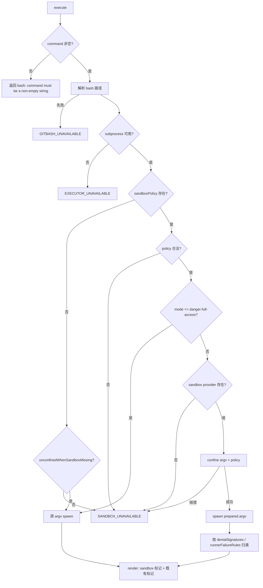

# dsh-gitbash v0.2.0 设计：沙箱优先

> **状态：0.2.0 已实施（2026-11-12，含审计修复轮）；0.2.1 兼容适配已实施（2026-11-19，as-of DSH 0.2.2-rc.5）；B1–B6 待执行。** 第 2 轮评审 PASS；S1/S2 已交付，真机 B1–B6 待在切换过策略的会话执行。bash 路径（P 系列）与 escalation 顺延到 0.2.2。
> 现行行为的权威源仍是 `docs/design.md`；本档描述 v0.2.0 的变更与验收，以及 0.2.1 的 rc.5 兼容适配。
> 事实基准：v0.2.0 为 as-of 2026-11-12 的 DSH 桌面版（内部包 0.2.2-rc.1）；0.2.1 适配为 as-of 2026-11-19（内部包 0.2.2-rc.5），Windows 10/11 + Git for Windows。

## 白话结论

1. v0.1.0 的 `bash` 工具绕过了宿主沙箱：`workspace-write` 会话里它能写工作区外，`read-only` 会话里也能写。v0.2.0 把它接回宿主同一套限制器。
2. 做法是复用 `ctx.sandbox` 这条 seam（官方 bash/pwsh 走的就是它），不是自己写 ACL/容器；沙箱服务不可用时**拒绝执行**，不静默降级。
3. 必须如实说清的代价：Windows 上宿主沙箱**只限制写**，不限制读、网络、进程可见性（源码注释原文如此）。要读隔离只能另走容器方案（非本批）。

## 需求（用户故事）

- **US-1** 在 `workspace-write` 会话里，用本工具写工作区外的文件必须失败，并给出与官方一致的 denial 标记。
- **US-2** 在 `read-only` 会话里，本工具的所有写操作必须失败；读命令照常可用。
- **US-3** 在 `danger-full-access` 会话里，行为与 v0.1.0 完全一致（零额外调用、零额外进程；「零额外调用」指不调 `confine`、不 spawn 额外进程——策略解析仍按 FR-S1 每次调用进行一次进程内读取）。
- **US-4** 宿主没有沙箱服务时，默认拒绝执行并说明原因；不允许「悄悄不受限执行」。
- **US-5** 沙箱 runner 自身故障与命令失败必须区分（前者明确说命令没有运行）。
- **US-6** 文档如实写明「只限写」的边界，不夸大。

## 背景

v0.1.0 有意做成平行 bash 工具：注册 `bash`，直接 `ctx.get("subprocess").spawn()`，不碰 `ctx.shell`（见 `docs/design.md` 的决策表）。这让它和 pwsh 共存，但也绕过了官方执行链的中间两层：`ctx.shell` 的沙箱执行器和 `ctx.sandbox.confine()`。结果是在受限会话里本工具没有文件效果 confinement。

## 问题

1. **执行路径绕过沙箱**：本仓库 `lib/index.js` 的 `execute()`（as-of 2026-11-12：第 199–232 行）直接构造
   `[bash, "--noprofile", "--norc", "-c", command]` 交给 `subprocess.spawn`（同文件第 220–221 行；`runArgv` 定义在第 91–135 行），
   全程没有任何 `ctx.sandbox` 参与。
2. **官方执行链有明确契约**（app.asar 内，as-of 2026-11-12 快照）：
   - `app.asar:/dsh/node_modules/@deepseek-ai/dsh-bash-sandbox/lib/index.js` 的 `SandboxBashExecutor.execute()`：
     `mode === "danger-full-access"` 直接执行，否则调用 `this.confine(spec.command, policy, signal)`；
   - 同文件 `confine()`：`ctx.sandbox.confine(["bash","-c",command], policy, signal)`；
   - `app.asar:/dsh/node_modules/@deepseek-ai/dsh-sandbox-local/lib/index.js` 的 `LocalSandboxProvider.confine()`：返回
     `{ argv, enforcement, denialSignatures, runnerFailureRules }`；Windows 分支是 ACL restricted-token runner
     （`enforcement = "partial"`：只限制写）；同文件 `windowsAclRunnerArgv()` 对 `read-only` 直接返回
     `--mode read-only` 的 runner argv（**不抛 unsupported**：只有 `workspace-write` + 额外可写目录才抛）。
3. **结果分类契约**（`app.asar:/dsh/node_modules/@deepseek-ai/dsh-sandbox/lib/index.js`）：
   `matchesSignature(exitCode, stderr, denialSignatures)` 判定 denial；`classifyRunnerFailure(exitCode, stderr, rules)`
   判定 runner 自身失败；标记文案由 `sandboxDenialMarker(mode)` 生成。
4. **策略来源契约**（`app.asar:/dsh/node_modules/@deepseek-ai/dsh-sandbox-policy/lib/index.js`）：
   `SandboxPolicyService.resolve({ session? })` 返回 `{ mode, workspaceRoot, additionalWritableRoots?, sessionId? }`；
   会话级覆盖来自会话日志里的 `sandbox/mode` 事件。
5. **agent 取法的宿主先例**（`app.asar:/dsh/node_modules/@deepseek-ai/dsh-tool-bash/lib/index.js` 的
   `resolveSandboxPolicy`）：`exec.agent === void 0 ? {} : { session: exec.agent.session }`——本设计采用同款取法（见 FR-S1）。
6. **本插件没有这些调用**，所以上面三件事对它都不成立。可对照的证据是：在 `workspace-write` 会话里，
   官方 bash 的写越界会被拒，而本工具不会。

## 目标（本批完成什么）

- 在 `read-only` / `workspace-write` 会话里，本工具的写效果与官方 bash 受同一套 enforcement。
- denial / runner 失败有与官方逐字一致的标记行。
- 沙箱不可用时 fail closed。
- `danger-full-access` 与 v0.1.0 行为完全一致。
- 不引入 `@deepseek-ai/*` 值导入（保持零解析风险）。
- 文档如实更新（README、docs/design.md、docs/install.md）。

### 非功能标准

- 失败方向：沙箱相关异常一律 fail closed（例外只有显式开关下的「无策略服务」）。
- 零宿主依赖：不 import 任何 `@deepseek-ai/*` 值（`from` / `require` 两种形态都不允许；lib 为纯 ESM）。
- 文案一致性：denial / runner 失败标记与宿主逐字一致。
- 无新增持久状态；诊断只写 `load-ok.txt` / `load-error.txt`（已 gitignore）。

## 非目标（本批不做）

- 读隔离与网络隔离（Windows 后端做不到；容器方案另批）。
- `sandbox_permissions` 升级/批准流程（0.2.2 候选；denial 后仍可用官方 pwsh 走批准）。
- 后台作业、bash 路径发现增强（P 系列，顺延 0.2.2）。
- 自研 ACL/Job/容器运行器。
- 沙箱模式切换 UI（宿主已有）。

## 决策与理由

| 决策 | 选择 | 为什么 | 被否决的备选 |
|---|---|---|---|
| 沙箱实现 | 复用 `ctx.sandbox` seam | 与官方同源；零新依赖；宿主升级自动跟随 | 自研限制令牌/ACL（重复实现、必漂移）；容器/WSL（重，另批） |
| 失败方向 | 默认 fail closed | 安全默认；与 `SandboxProvider` 契约一致（禁止静默不受限） | 静默降级（不安全的默认） |
| 缺服务兼容 | 显式开关 `unconfinedWhenSandboxMissing`，默认 `false` | 照顾没有沙箱服务的部署，但不影响安全默认 | 无开关（特殊部署不可用） |
| 升级流程 | 0.2.0 不做 | 缩小评审面；denial 后可用官方 pwsh 走批准 | 0.2.0 一并做（范围大、审批链路要复刻） |
| 分类实现 | 插件内复刻两个小函数 | 遵守零 `@deepseek-ai` 值导入；语义简单 | 直接 import（profile 插件解析不到宿主包） |
| 输出形态 | 仍是 `string` + 标记行 | 不破坏现有 schema/测试；与 v0.1.0 兼容 | 改结构化输出（无收益、破坏兼容） |
| 路径 | 顺延 0.2.2 | 用户指定沙箱优先；路径改动独立、低风险 | 同批发（扩大本批范围） |

## 方案

### FR-S1 策略解析（每次调用）

- `policySvc = safeGet("sandboxPolicy")`；`safeGet` 沿用现有 `ctx.get("subprocess")` 的写法（可能返回 `undefined`，也可能抛）。
- `policy = policySvc?.resolve(exec?.agent ? { session: exec.agent.session } : {})`。
  取法与官方 `dsh-tool-bash` 的 `resolveSandboxPolicy` 相同：`exec.agent` 缺失时用 `resolve({})`（部署默认策略）。
  这是**已知限制**：宿主 tool 调用一律带 agent；无 agent 的调用按部署默认走（与官方一致，T12b 锚定）。
- 校验：`policy` 是对象且 `mode` 属于 `{ "read-only", "workspace-write", "danger-full-access" }`；
  **服务在但返回非法 policy ⇒ 一律 fail closed**（`SANDBOX_UNAVAILABLE: malformed sandbox policy`），
  不适用 FR-S4 的缺失开关（T3b 锚定）。
- 解析抛错：按 `SANDBOX_UNAVAILABLE` 处理，**不 spawn**。

### FR-S2 受限执行

- 需要 confinement 的条件：`policy` 存在且 `policy.mode !== "danger-full-access"`。
- `sandbox = safeGet("sandbox")`；缺失 → fail closed（**不 spawn**）。
- `prepared = await sandbox.confine([bash, "--noprofile", "--norc", "-c", command], policy, exec?.signal)`。
- 校验返回：`Array.isArray(prepared?.argv) && prepared.argv.length > 0 && typeof prepared.argv[0] === "string"`；否则 fail closed。
- 保存 `{ enforcement, denialSignatures, runnerFailureRules }`（缺省按空数组/空规则处理）。
- spawn 使用 `prepared.argv`；`cwd / timeoutMs / env / stdio / graceMs / signal` 全部沿用现有逻辑。
- `confine` 抛错：不 spawn，按 FR-S4 返回错误文案。

### FR-S3 结果分类（仅当用了 confinement）

- **denial**：`exitCode` 是有限数字且非 0，且 `stderr` 命中任一 `denialSignatures`（大小写不敏感子串）
  → 追加 `[sandbox: file access denied under <mode> mode]`（与宿主逐字一致）。
- **runner 失败**：按 `runnerFailureRules` 逐条判定——
  `allowedExitCodes` 存在且不含当前退出码 → 跳过该条；
  逐行看 `stderr`：该行（小写）等于任一 `informationalLines`（小写）→ 跳过；
  该行包含任一 `fatalSignatures`（小写）→ 命中，返回该行。
  命中 → 追加 `[sandbox: the sandbox runner itself failed under <mode> mode — the command did not run; this is a sandbox problem, not a command failure]`。
- 标记顺序与官方 `renderResult` 一致：sandbox 标记在前，然后 `[timed out ...]` / `[error ...]` / `[signal ...]` / `[exit code: N]`。
- **runner 失败标记与退出码并存**：宿主在 runner 失败时抛错、不再渲染命令自身的标记；本插件的 runner 失败只是标记，因此 `[exit code: N]`（以及 denial 标记）会继续出现。这是本批的**明确取舍**，由 T8 锚定。
- 输出仍是 `string`；denial 不是异常，不抛。

### FR-S4 失败方向与开关

- 错误码映射：`error?.code` 若属于 `{ SANDBOX_UNAVAILABLE, SANDBOX_PREPARATION_FAILED, SANDBOX_INVALID_TEMP_ROOT, SANDBOX_UNSUPPORTED_POLICY, SANDBOX_INVALID_ROOT }` 就用它做首段（后两码保留给旧宿主；0.2.1 补 rc.5 两码）；
  否则一律 `SANDBOX_UNAVAILABLE`。文案形如 `<code>: <message>`。
- 无策略服务（`policySvc` 缺失）：默认返回
  `SANDBOX_UNAVAILABLE: the sandbox policy service is not composed in this profile; refusing to run unconfined.`；
  配置 `unconfinedWhenSandboxMissing: true` 时允许退回 v0.1.0 行为（文档标注「会绕过宿主策略」）。
- provider 缺失：即使开了上面的开关也**始终拒绝**（没有「缺服务也能跑」的路径）。
- 非法 policy（服务在、返回值不合法）：**不适用** `unconfinedWhenSandboxMissing`，一律 fail closed（见 FR-S1 / T3b）。

### FR-S5 描述、诊断与版本

- 工具 description 增补（与官方逐字一致，含反引号）：
  ``Commands may run under a file sandbox; a blocked file operation is reported as `[sandbox: file access denied under <mode> mode]`, a policy denial: do not retry another way.``
- `apply()` 的 `load-ok.txt` 追加 `sandboxServicesAtApply=present|missing`（0.2.1 从此前的 `sandboxServices` 改名；apply 时点读数，服务按可用性激活，不影响 apply 成败；T13 锚定）。
- 版本号 `0.2.0`。
- `README.md` / `docs/design.md` / `docs/install.md` 同步更新；`docs/install.md` 增 `unconfinedWhenSandboxMissing` 配置行与沙箱行为说明。

### FR-S6 测试与验收

单元测试（fake ctx，不需要 DSH 进程）：

| 编号 | 场景 | 断言 |
|---|---|---|
| T1 | `danger-full-access` | `confine` 未被调用；spawn 的 argv 是原 argv |
| T2 | `workspace-write` | `confine` 收到精确 argv 与 policy；spawn 用 `prepared.argv` |
| T2b | `read-only` | `confine` 收到 `mode="read-only"` 的 policy；spawn 用 `prepared.argv`；不抛 `SANDBOX_UNSUPPORTED_POLICY` |
| T3 | 无策略服务 + 默认开关 | 返回 `SANDBOX_UNAVAILABLE`；spawn 调用次数 0 |
| T3b | 策略服务在但返回非法 policy（含 `null`；开关为 true） | 返回 `SANDBOX_UNAVAILABLE: malformed sandbox policy`；spawn 0 次 |
| T4 | 无策略服务 + `unconfinedWhenSandboxMissing: true` | spawn 原 argv（显式绕过） |
| T5 | provider 缺失（mode 非 danger） | 返回 `SANDBOX_UNAVAILABLE`；spawn 0 次 |
| T6 | `confine` 抛 `SANDBOX_UNSUPPORTED_POLICY` | 文案以该码开头；spawn 0 次 |
| T7 | denial 签名命中 | 输出含 `[sandbox: file access denied under workspace-write mode]` |
| T7b | `read-only` denial | 输出含 `[sandbox: file access denied under read-only mode]` |
| T8 | runner 失败规则命中（标记与退出码并存） | 输出含 runner 失败标记、不含 denial 标记，且 [exit code: 127] 仍在 |
| T9 | `allowedExitCodes` + `informationalLines` 过滤 | 不误报 runner 失败 |
| T10 | 进程被信号杀死（无退出码） | 不判 denial |
| T11 | 零 `@deepseek-ai` 值导入 | 读 `lib/*.js`，断言无 `from "@deepseek-ai` 且无 `require("@deepseek-ai`；lib 为纯 ESM |
| T12b | `exec.agent` 缺失 | 以 `resolve({})` 取部署默认；按该 mode 决定是否 `confine`（与官方同款） |
| T13 | load-ok 诊断 | `apply(fakeCtx)` 后 `load-ok.txt` 含 `tool=bash` 与 `sandboxServicesAtApply=` |
| T14 | 受限模式下 runner 可执行文件启动失败（ENOENT/EACCES） | 返回 `SANDBOX_UNAVAILABLE: ... the command did not run ...`（含 code/path/syscall）；不追加 denial 标记；spawn 被尝试 1 次 |

真机验收（需要临时把一个会话切到 `workspace-write` / `read-only`；当前会话是 `danger-full-access`）：

| 编号 | 操作 | 判据 |
|---|---|---|
| B1 | `workspace-write`：工作区内写文件 | 成功 |
| B2 | `workspace-write`：写 `C:\Windows\...` | 失败，输出含 `[sandbox: file access denied under workspace-write mode]` |
| B3 | `workspace-write`：读工作区外文件 | 成功（记录为已知边界：读不受限） |
| B4 | `workspace-write`：`sleep 100` + 1s 超时 | 超时标记出现；无残留 `bash.exe` / runner 进程 |
| B5 | `danger-full-access` 会话回归 | 行为与 v0.1.0 一致；`uname -s` 仍为 MINGW64 |
| B6 | `read-only`：写工作区文件；读工作区外文件 | 写失败并含 `[sandbox: file access denied under read-only mode]`；读成功 |

read-only 可行性依据：`windowsAclRunnerArgv()` 对 `read-only` 直接返回 `--mode read-only` 的 runner argv，
不抛 `SANDBOX_UNSUPPORTED_POLICY`（0.2.2-rc.5 起该异常已不存在；额外可写目录对进程沙箱不生效；as-of 2026-11-19 快照）。

## 机制伪代码

```js
async execute(args, exec) {
  const command = typeof args?.command === "string" ? args.command : "";
  if (command.trim().length === 0) return "bash: command must be a non-empty string";

  let bash;
  try { bash = resolveBashPath(config.bashPath, candidateBashPaths()); }
  catch (error) { return errorText(error); }          // GITBASH_UNAVAILABLE

  let subprocess;
  try { subprocess = ctx.get("subprocess"); } catch { subprocess = undefined; }
  if (!subprocess?.spawn) return "EXECUTOR_UNAVAILABLE: ...";

  const policySvc = safeGet(ctx, "sandboxPolicy");
  let policy;
  try { policy = policySvc?.resolve(exec?.agent ? { session: exec.agent.session } : {}); }
  catch (error) { return unavailable(error); }        // fail closed

  const VALID_MODES = new Set(["read-only", "workspace-write", "danger-full-access"]);
  if (policy !== undefined && (policy === null || typeof policy !== "object" || !VALID_MODES.has(policy.mode))) {
    return unavailable("malformed sandbox policy");   // never covered by the switch
  }

  let prepared;
  if (policy !== undefined && policy.mode !== "danger-full-access") {
    const sandbox = safeGet(ctx, "sandbox");
    if (sandbox === undefined) return unavailable("sandbox provider service is not composed");
    try { prepared = await sandbox.confine([bash, "--noprofile", "--norc", "-c", command], policy, exec?.signal); }
    catch (error) { return unavailable(error); }      // fail closed, never spawn
    if (!Array.isArray(prepared?.argv) || prepared.argv.length === 0) return unavailable("sandbox returned no argv");
  } else if (policy === undefined && !config.unconfinedWhenSandboxMissing) {
    return unavailable("sandbox policy service is not composed");
  }

  const argv = prepared ? prepared.argv : [bash, "--noprofile", "--norc", "-c", command];
  const value = await runArgv({ spawn: subprocess.spawn, argv, cwd, timeoutMs, graceMs, /* ... */ });
  return renderResult(value, prepared ? classifySandbox(value, policy.mode, prepared) : []);
}
```

前置：`command` 非空；`bash` 可解析；`subprocess.spawn` 可用；`exec.signal` 可缺省。
后置：只在 `danger-full-access`（或显式开关下无策略服务）时以原 argv 执行；其余路径要么 spawn `prepared.argv`，
要么在 spawn 之前返回错误。返回恒为 `string`。

## 状态与 schema

- 配置新增：`unconfinedWhenSandboxMissing: boolean`（默认 `false`）；其余六个字段不变。
- 环境变量不变。
- 无持久化状态；`load-ok.txt` / `load-error.txt` 仍是本地诊断文件（已进 `.gitignore`）。
- 输出：仍是 `string`；新增的只有标记行，无 schema 变化。
- 版本：`0.2.0`。

## 防偏离

| 检查 | 命令 | 判据 |
|---|---|---|
| R1 全量测试 | `npm test` | 现有 14 例 + 沙箱 17 例（T1–T14 及其变体 T2b/T3b/T7b/T12b）全过（合计 31 例） |
| R2 未导入宿主包 | `grep -rn 'from "@deepseek-ai\|require("@deepseek-ai' lib/` | 0 命中 |
| R3 危险全权等价 | T1 + 真机 B5 | 与 v0.1.0 行为一致 |
| R4 失败闭合 | T3 / T3b / T5 / T6 | spawn 调用次数为 0 |
| R5 标记文案 | T7 / T7b / T8 | 与宿主逐字一致（含 read-only 变体） |
| R6 真机写越界 | 手动 `workspace-write` 会话（B1 / B2） | 被拒 + denial 标记 |
| R7 真机读越界与 read-only | 手动 `workspace-write` / `read-only` 会话（B3 / B6） | 读成功（边界记录）；read-only 写被拒 |
| R8 超时不残留 | 手动 `sleep 100` + 1s（B4） | 无残留进程 |
| R9 文档 | 人工检查 | README/design.md/install.md 不再声称「不做沙箱」，且无指向本档不存在 FR 的过期指称 |

负向断言（必须红过）：把 `confine` 结果丢掉、返回原 argv 时，T2 必须失败；把 fail-closed 改成静默执行时，T3/T3b/T5 必须失败。

## 边界

- **Windows 只限写**：`windows-acl` 的 enforcement 是 `partial`；读、网络、进程可见性不受限
  （源码注释：「writes are restricted; reads, network, and process visibility are NOT」）。
- **additionalWritableRoots 对进程不生效**：DSH 0.2.2-rc.5 起 Windows 进程沙箱忽略额外可写目录（不再抛 `SANDBOX_UNSUPPORTED_POLICY`；只有文件工具认这些 grant），写这些目录会被 ACL 拒。与官方 bash 一致。
- **沙箱准备失败（0.2.2-rc.5）**：`SANDBOX_PREPARATION_FAILED`（ACL / 私有临时目录准备失败）与 `SANDBOX_INVALID_TEMP_ROOT`（TEMP 落在工作区内）；本工具原样透传首段令牌，不重试、不降级。
- **`read-only`**：所有写都被拒；读命令照常（`windowsAclRunnerArgv()` 对 read-only 返回 `--mode read-only` 的 runner argv，不抛 unsupported；as-of 2026-11-12 快照）。
- **超时/中止**：`exec.signal` 同时传给 `confine` 与 `subprocess.spawn`；宿主负责杀进程树；
  runner 是宿主 node 进程，需要 B4 验证子进程不残留。
- **空集/畸形输入**：空命令、bash 不存在、subprocess 缺失的既有文案不变；`confine` 返回畸形 argv 时 fail closed。
- **并发**：策略按调用解析，无跨调用缓存；不缓存 mode（会话可在两次调用之间切换）。
- **重启/升级**：seam 是宿主内部 API，宿主升级可能改返回形状；FR-S2 的形状校验让不兼容 fail closed，
  测试 T1–T14 及其变体（T2b/T3b/T7b/T12b）作为锚。
- **失败方向**：一律 fail closed；唯一例外是显式开关下的「无策略服务」。

## 图示



## 实施计划（eng_coder 阶段）

| 阶段 | 范围 | 文件 | 验收（宿主执行） |
|---|---|---|---|
| S1 | 配置 + 分类器 + execute 接入 + 单测 | `lib/index.js`、`test/tool.test.mjs` | `npm test` 全绿（含 T1–T14 及其变体 T2b/T3b/T7b/T12b） |
| S2 | 文档与版本同步 | `README.md`、`docs/design.md`、`docs/install.md`、`package.json`、本档状态 | `npm test` 全绿；R2/R9 通过；README/design.md 的路径指称已指向 0.2.2（0.2.1 起再顺延 0.2.2，见 0.2.1 小节） |
| S3 | 真机验收（不是 eng_coder 阶段） | — | B1–B6 由用户在切换过策略的会话执行 |

## 已拍板（2026-11-12）

| # | 决策 | 结论 |
|---|---|---|
| 1 | Windows「只限写」沙箱 | **接受**。宿主 `windows-acl` 只限制写；读隔离另立容器批次。 |
| 2 | 0.2.0 是否包含 `sandbox_permissions` 升级 | **不包含**，0.2.1 再补；denial 后可改用官方 pwsh。 |
| 3 | 缺沙箱服务行为 | **默认 fail closed**，保留显式开关 `unconfinedWhenSandboxMissing`（默认 `false`）。 |
| 4 | 路径 P 系列排期 | **顺延 0.2.1**，沙箱优先。 |

> 以上为 2026-11-12 用户拍板（原话「都按建议」），作为本设计的决策基线；
> 第 1 条接受的是「写边界」，不包含读/网络隔离。

## 评审修订记录（第 1 轮，2026-11-12）

| 评审 # | 级别 | 处置 |
|---|---|---|
| 1 | 🔴 | 新增 T2b / T7b / A10（审计修复轮改名为 B6）与 read-only 可行性证据（`windowsAclRunnerArgv()`） |
| 2 | 🟡 | 真机验收统一 A5–A10（审计修复轮改名为 B1–B6）；防偏离改用 R1–R9 |
| 3 | 🟡 | 非法 policy 一律 fail closed（不适用缺失开关）；新增 T3b；伪代码与流程图同步 |
| 4 | 🟡 | 采用①：agent 缺失用 `resolve({})`（对齐 `dsh-tool-bash`）；新增 T12b；边界注明 |
| 5 | 🟡 | S2 明确把 README/design.md 的路径指称改为 0.2.1；R9 检查无过期指称 |
| 6 | 🟡 | 问题节补本仓行号与宿主文件级路径（as-of 2026-11-12 快照） |
| 7 | 🔵 | 「目标」下新增「非功能标准」 |
| 8 | 🔵 | S2 写明 install.md 改动；新增 T13（load-ok 含 `sandboxServices=`） |
| 9 | 🔵 | 导入断言覆盖 `from` / `require`；注明 lib 为纯 ESM |

## 审计修复轮记录（2026-11-12）

实施后审计发现 8 项，本轮只修这 8 项，不新增设计。S1/S2 的交付物按上表与 FR 修订；修复后的 `npm test` 由宿主在两种 PATH 下执行（本档不预填结果）。

| 审计 # | 级别 | 处置 |
|---|---|---|
| 1 | 🔴 | T7b 夹具把宿主 windows-acl 方言 `permission denied` 补进 `denialSignatures`；断言仍验证 read-only 标记且标记在 `[exit code: 5]` 之前。实现未改 |
| 2 | 🟡 | 真实调用档改为「解析结果必须是 Git Bash」：排除 `System32\bash.exe` 候选，跑 `uname -s` 要求 MINGW/MSYS/CYGWIN，不匹配则 skip；README / docs/design.md 的 skip 表述同步 |
| 3 | 🟡 | T1–T13 的 14 个 fake-ctx 用例，连同同样不需要真实 bash 的「空命令 / 缺服务」用例，改用 `process.execPath` 作假 `bashPath` 并去掉过宽 skip；argv 断言改用假 bash 路径；真实调用档（4 例）保留 Git Bash 门控 |
| 4 | 🟡 | 受限模式下 runner 启动失败（ENOENT/EACCES）归为 `SANDBOX_UNAVAILABLE: ... the command did not run ...`，不追加 denial 标记；`runArgv` 保留 code/path/syscall；新增 T14；danger-full-access 文案不变 |
| 5 | 🔵 | description 增补句与宿主逐字一致（`[sandbox: ...]` 带反引号）；`lib/index.js` 与 FR-S5 同改 |
| 6 | 🔵 | 机制伪代码补 `policy === null` 守卫，与本档 FR-S1 及实现一致 |
| 7 | 🔵 | T8 改名为「runner 标记与退出码并存、不被判 denial」，新增 `[exit code: 127]` 断言；FR-S3 写明与宿主抛错行为的差异属本批明确取舍 |
| 8 | 🔵 | 真机验收统一改名 B1–B6；R3 / R6 / R7 / R8 / S3、install.md、README（无引用）同步；install.md 增加 A 系 / B 系编号映射说明 |

## 交付评审（第 1 轮，2026-11-12）

代码评审（advisor type=code）PASS，无 🔴。5 条发现的处置：

| 评审 # | 级别 | 处置 |
|---|---|---|
| 1 | 🟡 | 修正 install.md 的 A 系编号说明：脚本内 A1–A4 与 docs/design.md 的 A1–A4 含义不同，执行以各自表格为准 |
| 2 | 🟡 | **顺延 0.2.1**：`node --test`（T13）会刷新 `load-ok.txt`，可能让 acceptance A2 在未重启时误绿。本批先在 install.md 加操作告警（A2 在重启后、跑测试前执行）；根治需要可注入的 breadcrumb 路径（设计变更），列入 0.2.1 |
| 3 | 🟡 | 非缺陷：B1–B6 真机验收待用户执行；文档状态已如实标注「未执行」 |
| 4 | 🔵 | US-3 措辞补注：「零额外调用」= 不调 `confine`、不 spawn 额外进程；策略解析按 FR-S1 每次进行 |
| 5 | 🔵 | .gitignore 删除 v1 遗留的 `probe-baseline.txt` / `probe-loaded.txt` |

## 0.2.1 兼容适配（DSH 0.2.2-rc.5，2026-11-19）

> 用户升级 DSH 后要求核查并适配。0.2.1 只做兼容修复，**不改变 v0.2.0 的沙箱语义**；
> 原计划里顺延到 0.2.1 的路径（P 系列）、`sandbox_permissions` 升级与 breadcrumb 根治一并顺延 0.2.2。

### 需求与背景

实测（as-of 2026-11-19，DSH 0.2.2-rc.5）：DSH 桌面版已升到该内部包；插件能加载（`load-ok.txt` 写入本版代码的字段），
`bash` 工具真实返回 `MINGW64_NT-10.0-26200`，仓库 `npm test` 31/31 通过。rc.5 的沙箱 seam 有两处行为变化需要跟进：

1. `dsh-sandbox` 新增 `SandboxPreparationError`（码 `SANDBOX_PREPARATION_FAILED` / `SANDBOX_INVALID_TEMP_ROOT`）；
   旧的 `SANDBOX_UNSUPPORTED_POLICY` 不再抛出/导出。
2. `dsh-sandbox-policy` 的 `resolve()` 会合并会话级可写目录注册；Windows 进程沙箱**忽略**这些额外目录（只有文件工具认 grant）。

另外，插件 `apply()` 时沙箱服务尚未挂载（服务按可用性激活），所以 `load-ok.txt` 里
`sandboxServices=missing`（0.2.1 改名前使用的字段名）是时点读数，不是运行期缺失（本机实测如此；运行期 `execute()` 能找到两个服务）。

### 目标 / 非目标

- 目标：rc.5 的 preparation 错误码原样透出；诊断字段名如实；文档口径与 rc.5 一致；版本 0.2.1。
- 非目标：不改 `confine` 调用形状/结果分类；不做 escalation、不做路径增强、不根治 T13 覆盖 `load-ok.txt` 的问题（均顺延 0.2.2）。

### 决策

| 决策 | 选择 | 理由 | 备选 |
|---|---|---|---|
| 错误码 | 追加 rc.5 两码，保留旧码 | 新旧宿主都能给出准确首段令牌；旧码在旧 DSH 仍有效 | 只加新码（旧宿主丢令牌）；不改（误标 `SANDBOX_UNAVAILABLE`） |
| 诊断字段 | `sandboxServices` → `sandboxServicesAtApply` | 名字如实反映「apply 时点」；运行期可用性由 `execute()` 保证 | 删字段（丢诊断）；延迟写入（增加生命周期复杂度） |
| 额外可写目录 | 文档改为「进程不生效、文件工具生效」 | 与 rc.5 官方 bash 一致；不改变本插件行为 | 维持旧文档（与宿主行为矛盾） |
| 版本 | 0.2.1 | 兼容修复不改变设计语义 | 并入 0.2.0（已提交但未发布） |

### 方案（FR-C1..C4）

- **FR-C1 错误码映射**：`SANDBOX_ERROR_CODES` 增加 `SANDBOX_PREPARATION_FAILED` / `SANDBOX_INVALID_TEMP_ROOT`；
  保留 `SANDBOX_UNAVAILABLE` / `SANDBOX_UNSUPPORTED_POLICY` / `SANDBOX_INVALID_ROOT`（旧 DSH 兼容）。
  `sandboxErrorText` 行为不变。
- **FR-C2 诊断字段**：`apply()` 写 `sandboxServicesAtApply=present|missing`；注释写明时点语义；T13 同步改名。
- **FR-C3 文档修正**：README / docs/design.md / docs/install.md 更新：额外可写目录对进程不生效（不再抛
  `SANDBOX_UNSUPPORTED_POLICY`）；新增两个 preparation 错误码的排查项；as-of 升到 rc.5 / 2026-11-19。
- **FR-C4 版本与排期**：`package.json` 0.2.1；路径 / escalation / breadcrumb 根治顺延 0.2.2。

### 受影响文件与阶段

| 阶段 | 文件 | 改动 | 验收（宿主执行） |
|---|---|---|---|
| F1 | `lib/index.js` | `SANDBOX_ERROR_CODES` 追加 rc.5 两码（旧码保留）；`apply()` 诊断字段改名 `sandboxServicesAtApply` | — |
| F1 | `test/tool.test.mjs` | T13 断言随 FR-C2 改名；新增 T15 / T16（工具测试 25 例：功能 6 + 沙箱 19） | `npm test` |
| F1 | `package.json` | 版本 `0.2.1` | — |
| F2 | `README.md`、`docs/design.md`、`docs/install.md` | FR-C3 口径同步：额外可写目录、两个 preparation 错误码、诊断字段时点语义；版本与计数同步 | — |
| F2 | `docs/v0.2-design.md` | 本小节与状态行（v0.2.0 历史不动） | `npm test` |

> **机制不变豁免（评审 #6）**：问题根因见上文「需求与背景」的 rc.5 实测段；机制伪代码 / 状态与 schema / 防偏离沿用 FR-S2、FR-S4 与上文，本小节不重复。

### 验收

| 检查 | 判据 |
|---|---|
| 全量测试 | `npm test`：0.2.0 的 31 例 + T15/T16 = 33 例全过；真实调用档仍按 Git Bash 门控 |
| T15 | `confine` 抛 `SANDBOX_PREPARATION_FAILED` → 首段令牌准确、spawn 0 次 |
| T16 | `SANDBOX_INVALID_TEMP_ROOT` 同上 |
| 文档（当前态 prose） | `README.md` / `docs/design.md` / `docs/install.md` 无 `sandboxServices=` 旧字段；无「额外目录会抛 `SANDBOX_UNSUPPORTED_POLICY`」的旧论断（历史表与 as-of 快照豁免，评审 #4） |
| 文档正向 | `docs/install.md` 常见故障表含 `SANDBOX_PREPARATION_FAILED` 与 `SANDBOX_INVALID_TEMP_ROOT`（评审 #5） |
| 回归 | 31 例全绿（T13 断言随 FR-C2 改名）；danger-full-access 路径零行为变化（评审 #9） |

### 边界

- 新错误码的触发条件由宿主决定（ACL 授权失败 / TEMP 在工作区内）；本插件只透传，不重试、不降级。
- 服务挂载顺序仍是可用性驱动：apply 时 missing ≠ 运行期 missing；`execute()` 时两服务必须存在，否则 fail closed。
- T13 仍会覆盖真实 `load-ok.txt`（离线测试副作用），该已知问题顺延 0.2.2。
- rc.5 的 `SandboxPreparationError` 只在 preparation 失败时抛；普通 denial 仍由 `denialSignatures` 分类。

### 评审处置（第 1 轮，2026-11-19）

| 评审 # | 处置 |
|---|---|
| 4 | 验收的文档检查限定为当前态 prose；历史表与 as-of 快照豁免 |
| 5 | 新增正向检查：`docs/install.md` 常见故障含 `SANDBOX_PREPARATION_FAILED` / `SANDBOX_INVALID_TEMP_ROOT` |
| 6 | 补「机制不变豁免」说明：根因见上文 rc.5 实测段；伪代码 / 状态与 schema / 防偏离沿用 FR-S2、FR-S4 与上文 |
| 7 | 状态行改为明确「0.2.0 已实施；0.2.1 兼容适配已实施（2026-11-19）」 |
| 9 | 回归行改为「31 例全绿（T13 断言随 FR-C2 改名）」 |
| 11 | as-of 锚点统一到 rc.5（2026-11-19），历史记录不动 |

### 交付评审处置（0.2.1，2026-11-19）

代码评审（advisor type=code）PASS，无 🔴。4 条发现的处置：

| 评审 # | 级别 | 处置 |
|---|---|---|
| 1 | 🟡 | 文档层修正：机制伪代码 `classifySandbox(value, policy.mode, prepared)`；`safeGet` 补 `ctx` 形参（与实现一致） |
| 2 | 🔵 | S2 验收行加 as-of 括注（0.2.1 起路径指称再顺延 0.2.2，见本小节），消除页内 0.2.1/0.2.2 歧义 |
| 3 | 🔵 | 已知遗留：`apply()` 的 breadcrumb 固定写包根 `load-ok.txt`，离线测试会覆盖；维持 0.2.2 登记（install.md 已告警） |
| 4 | 🔵 | `sandboxErrorText` 对「带 `code`/`message` 的普通对象」的兜底；顺延 0.2.2（宿主当前抛 Error 实例，仅诊断边角） |


