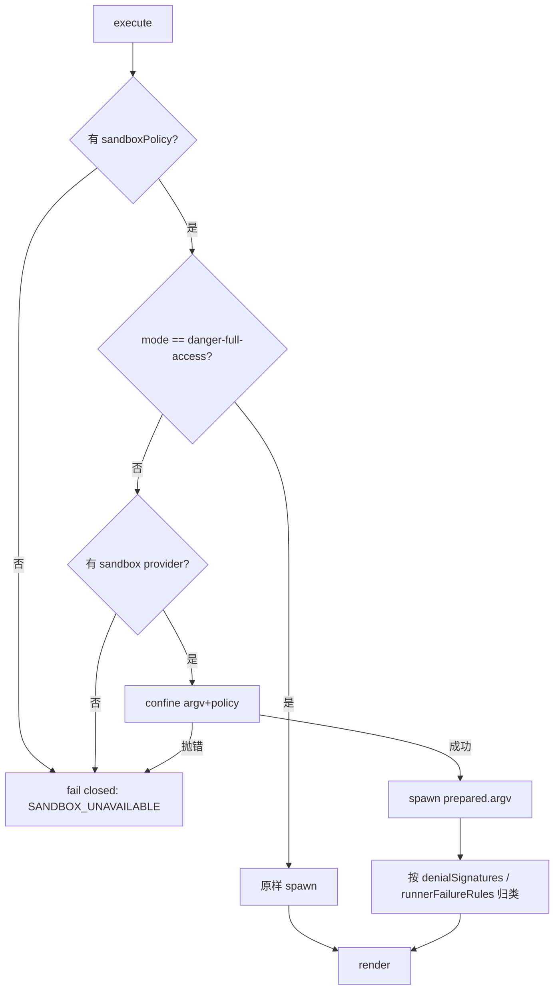

# dsh-gitbash v0.2 提案：沙箱与 bash 路径

> **状态：提案，未实施。** 本档回答两个问题：① 沙箱怎么做；② bash 路径怎么配。
> 事实基准：as-of 2026-11-11 的 DSH 桌面版（内部包版本 0.2.2-rc.1），Windows 10/11 + Git for Windows。
> v0.1.0 的现状见 `docs/design.md`；本档不是当前行为的权威源。

## 背景

v0.1.0 有意做成「平行 bash 工具」：注册一个名为 `bash` 的工具，直接
`ctx.get("subprocess").spawn()` 拉起本机 `bash.exe`，不碰 `ctx.shell`（见 design.md 的决策表）。
这个选择的代价是：**不提供沙箱 confinement**。在 `workspace-write` / `read-only` 会话里，
官方 bash/pwsh 会被宿主限制写边界，而本工具不会。下一版要回答的就是：能不能在不重复造轮子的
前提下补上 confinement，以及路径配置怎么做到可诊断。

## 问题

1. **confinement 缺口**：`lib/index.js` 的 `execute()` 直接调用 `subprocess.spawn`，没有经过
   `ctx.sandbox.confine()`。官方链是
   `tool-bash → ctx.shell（SandboxBashExecutor）→ ctx.sandbox.confine(argv, policy) → 受限 runner → spawn`；
   本工具绕过了中间两层。证据（as-of 上述版本，app.asar 内）：
   `@deepseek-ai/dsh-bash-sandbox` 的 `SandboxBashExecutor.execute()` 与 `confine()`、
   `@deepseek-ai/dsh-sandbox-local` 的 `LocalSandboxProvider.confine()`。
2. **路径不可诊断**：`bashPath` 配错时工具照样注册成功，只有每次调用才报
   `GITBASH_UNAVAILABLE`；候选链没有任何「试了哪些、为什么都不行」的输出。
3. **PATH 兜底可能命中 WSL**：Windows 的 `%SystemRoot%\System32\bash.exe` 是 WSL 启动器
   （本机实测存在，86 KB）。候选链最后是 `PATH` 各目录，极端情况下会选中它，得到 Linux 语义
   （`uname -s` = `Linux`）而不是 Git Bash。
4. **没有升级杠杆**：官方工具在 denial 之后可用 `sandbox_permissions` + `justification`
   走一次用户批准；本工具没有这个参数。

## 目标

- 会话策略是 `read-only` / `workspace-write` 时，本工具与官方 bash 使用**同一个**
  `ctx.sandbox` enforcement，结果里出现与官方一致的 denial / runner-failure 标记。
- 沙箱不可用时不静默降级：**fail closed**，明确报 `SANDBOX_UNAVAILABLE`。
- 路径解析可诊断：一个命令打印候选与判定；配置错误在装载时就留下记录。
- 配置仍然**只由运维/用户**决定，模型不能按调用改可执行文件。

## 非目标

- 不替换 `ctx.shell`；不实现自己的 ACL/Job/容器运行器。
- 不承诺读隔离或网络隔离（Windows 的 `windows-acl` 后端做不到，见「边界」）。
- 不做每调用 `bashPath` 覆盖；不引入 WSL/MSYS2/Cygwin 支持。
- 后台作业（`run_in_background`）另批，不在本提案。

## 决策与理由

### 决策 1：沙箱复用宿主 seam，而不是自己造

| 方案 | 做法 | 优点 | 代价 / 否决理由 |
|---|---|---|---|
| **A. 复用 `ctx.sandbox`（建议）** | `ctx.get("sandboxPolicy").resolve()` 取策略；`ctx.get("sandbox").confine(argv, policy, signal)` 取受限 argv | 与官方 bash/pwsh 同一套 enforcement；零新依赖；宿主升级自动跟随；`danger-full-access` 下零开销 | Windows 上是 `partial` enforcement（只限写）；绑死宿主内部 seam（但这是插件已经依赖的同一运行环境） |
| B. 插件内自研 Windows 限制令牌 + ACL | 自己建 restricted token + Job + ACE | 可以加自己的策略（例如网络） | 与宿主同源实现重复、语义会漂移、Win32 细节多；官方已经把这层做成 seam |
| C. 容器 / WSL 执行 | 把命令送进 Docker/WSL | 可做读 + 写 + 网络隔离 | 重：依赖外部运行时，路径映射、性能、交互全要重做；不是本插件的职责 |

**建议 A。** 并且必须如实告诉用户：在 Windows 上，DSH 的 `windows-acl` 后端**只限制写**，
读、网络、进程可见性都不受限（源码注释原文：
“writes are restricted; reads, network, and process visibility are NOT”）。如果目标是
「进程读不到工作区外的秘密」，A 不解决，只有 C 那条路；建议把这一点写进 README 的边界说明。

### 决策 2：路径配置保持单一 operator 入口

`bashPath` 仍是最高优先级且**声明即唯一**（无效就报错、不回退）。新增的只是**发现能力**与
**可诊断性**，不新增「模型可改路径」的入口。

## 方案

### 沙箱（FR-S）

**FR-S1 策略解析**：每次 `execute()` 调
`ctx.get("sandboxPolicy")?.resolve(session ? { session } : {})`；拿到
`{ mode, workspaceRoot, additionalWritableRoots?, sessionId? }`。`session` 取自
`exec.agent?.session`（与官方工具同源）。

**FR-S2 受限执行**：
- `mode === "danger-full-access"`：原样 spawn，不调 `confine`。
- 其余模式：`ctx.get("sandbox")` 必须存在；调用
  `confine([bash, "--noprofile", "--norc", "-c", command], policy, exec.signal)`，
  返回 `{ argv, enforcement, denialSignatures, runnerFailureRules }`，把返回的 `argv` 交给
  `subprocess.spawn`。
- `confine` 抛错（含宿主在 Windows 不支持 `additionalWritableRoots` 时的
  `SANDBOX_UNSUPPORTED_POLICY`）：直接返回可读错误，**绝不退回不受限执行**。

**FR-S3 结果分类**（与宿主同文案，便于模型识别）：
- denial：`exitCode !== 0` 且 stderr 命中 `denialSignatures`（大小写不敏感子串）⇒ 追加
  `[sandbox: file access denied under <mode> mode]`。
- runner 自身失败：按 `runnerFailureRules`（允许的退出码 + fatal 签名，排除 informational 行）
  ⇒ 追加 `[sandbox: the sandbox runner itself failed under <mode> mode — the command did not run; this is a sandbox problem, not a command failure]`，
  并把结果标记为基础设施失败（不是命令失败）。
- 这两个分类器在宿主里是 `@deepseek-ai/dsh-sandbox` 的导出函数；本插件按 design.md FR-1 的
  「零 `@deepseek-ai/*` 值导入」约束，在插件内复刻同语义的小函数（约 30 行），并用锚测试
  固定文案。若将来 profile 能稳定解析这些包，再改回导入。

**FR-S4 失败方向**：`sandboxPolicy` 缺失时默认 **fail closed**（返回
`SANDBOX_UNAVAILABLE`，说明宿主没有沙箱策略服务）；提供 `unconfinedWhenSandboxMissing: true`
作为**显式**的兼容开关（默认 `false`，文档标注「会绕过宿主策略」）。

**FR-S5 升级杠杆（第二期，可选）**：加 `sandbox_permissions` + `justification` 参数，
按宿主的严格更宽表（`read-only → workspace-write | danger-full-access`，
`workspace-write → danger-full-access`）通过 `ctx.get("approval").request(...)` 申请一次批准；
批准结果只作用于本次调用。没有 approval 服务时按 fail closed 处理。

### 路径（FR-P）

**FR-P1 候选链（v0.2）**：
① 配置 `bashPath` → ② `DSH_GITBASH_PATH` → ③ `DSH_GITBASH_ROOT` / `GIT_INSTALL_ROOT` →
④ 注册表 `HKLM\SOFTWARE\GitForWindows` 的 `InstallPath`（本机实测存在；32/64 视图都看）→
⑤ 由 `git.exe` 同级推导（`<root>\cmd\git.exe` 或 `<root>\bin\git.exe` ⇒ `<root>\bin\bash.exe`）→
⑥ 常见目录（`%ProgramFiles%\Git`、`%ProgramFiles(x86)%\Git`、`%ProgramW6432%\Git`、
`%LOCALAPPDATA%\Programs\Git`）→ ⑦ `PATH`。

**FR-P2 候选校验**：`PATH` 与自动发现得到的候选要过「Git Bash 签名」检查——至少拒绝
`%SystemRoot%\System32\bash.exe`（WSL 启动器）；更稳的做法是 `bash -c 'echo $MSYSTEM'`
或 `bash --version` 里必须出现 `MINGW`/`MSYS`/`CYGWIN`。显式 `bashPath` 不做静默替换，
但装载记录里标注实测版本，配错时给出同样的检查提示。

**FR-P3 输入归一化**：`bashPath` 接受「exe 文件」或「Git 安装根目录 / `bin` 目录」；
展开 `%VAR%` / `~`、统一正反斜杠；`git-bash.exe` 明确拒绝并提示改用 `bin\bash.exe`。

**FR-P4 装载预检**：`apply()` 里跑一次解析（只 stat，不 spawn），把结果写进
`load-ok.txt`（含 `bash=<path>`、`mode=...`）或 `load-error.txt`；运行期缓存成功结果，
spawn 报 `ENOENT` 时清缓存重试一次。

**FR-P5 诊断入口**：`node lib/resolve.js --json` 打印候选清单（来源、是否存在、是否可执行、
为什么不选），install.md 的故障排查用它；`tools/acceptance.ps1` 的 A2 改为读 `load-ok.txt`
（v0.1.0 已改）。

**FR-P6 测试**：用注入的 fs/env/registry/git 探针做表驱动；负向断言覆盖
「声明无效不回退」「WSL 候选被拒」「PATH 不含 System32 bash」「目录输入展开」。

## 机制伪代码

```js
async execute(args, exec) {
  const policy = ctx.get("sandboxPolicy")?.resolve(exec.agent ? { session: exec.agent.session } : {});
  const bash = resolveBashPath(config.bashPath, candidateBashPaths());

  let prepared;
  if (policy === undefined) {
    if (!config.unconfinedWhenSandboxMissing) return SANDBOX_UNAVAILABLE_TEXT;
  } else if (policy.mode !== "danger-full-access") {
    const sandbox = ctx.get("sandbox");
    if (sandbox === undefined) return SANDBOX_UNAVAILABLE_TEXT;
    try {
      prepared = await sandbox.confine([bash, "--noprofile", "--norc", "-c", command], policy, exec.signal);
    } catch (error) {
      return "SANDBOX_UNAVAILABLE: " + error.message; // fail closed
    }
  }

  const argv = prepared?.argv ?? [bash, "--noprofile", "--norc", "-c", command];
  const value = await runArgv({ spawn: subprocess.spawn, argv, /* … */ });
  return renderResult(value, prepared ? classify(value, prepared) : []);
}
```

前置：`policy` 可缺省（无策略服务）；`bash` 已解析成功；`exec.signal` 可缺省。
后置：只有 `policy` 为 `danger-full-access`（或无策略且显式开了兼容开关）时才会以原 argv 执行；
其余路径要么走 `confine` 返回的 argv，要么在 spawn 之前返回错误。

## 状态与 schema

- 配置新增：`unconfinedWhenSandboxMissing?: boolean`（默认 `false`）；`bashPath` 语义扩展
  （exe 或目录），其余字段不变。
- 环境变量不变：`DSH_GITBASH_PATH` / `DSH_GITBASH_ROOT` / `GIT_INSTALL_ROOT`。
- 无持久化状态；`load-ok.txt` / `load-error.txt` 仍是本地诊断文件（已进 `.gitignore`）。
- 输出仍是 `string`；新增的只有标记行，无 schema 变化。

## 防偏离

| 检查 | 命令 | 判据 |
|---|---|---|
| S0 danger passthrough | `node --test` | `danger-full-access` 时 `confine` 未被调用，spawn 的 argv 原样 |
| S1 confined argv | 单测 fake sandbox | `workspace-write` 时 spawn 的 argv === `prepared.argv` |
| S2 fail closed | 单测 | sandbox 缺失 / `confine` 抛错时 spawn 调用次数为 0 |
| S3 标记 | 单测 | denial / runner-failed 文案与宿主逐字一致 |
| P0 链 | 单测 | 顺序、去重、来源（v0.1.0 已有 8 例） |
| P1 负向 | 单测 | 声明无效不回退；WSL shim 被拒 |
| P2 真机 | `workspace-write` 会话 | 工作区内写成功；`C:\Windows` 写被拒并出 denial 标记；读工作区外**不**被拒（记录为已知边界） |

## 边界

- `windows-acl` 的 enforcement 是 `partial`：**只限写**；读、网络、进程可见性不受限。
  不要宣传成「完整沙箱」。
- Windows 不支持 `additionalWritableRoots`：`confine` 抛 `SANDBOX_UNSUPPORTED_POLICY`，
  本工具转成可读错误，不降级。
- `read-only`：所有写都拒；`workspace-write`：工作区 + 平台 temp 可写。
- 超时 / 中止：依赖宿主 subprocess 的 kill 语义；runner 是宿主 node 进程，需确认
  kill-on-close 后子进程不残留。
- 沙箱服务缺失：fail closed（除非显式开关）。
- `danger-full-access` 下行为与 v0.1.0 完全一致。
- 注册表缺失 / 不可读：跳过，不报错。
- 显式 `bashPath` 指向 WSL bash：不静默替换，但在 load 记录与错误文案里提示。
- 并发：策略按调用解析，无跨调用缓存。

## 流程



## 实施顺序

1. P 系列（纯路径，独立、可先发）。
2. S1–S4（confinement + fail closed + 标记）。
3. 真机验收（`workspace-write` 会话）。
4. S5 escalation 与后台作业放到另一个批次。

## 开放问题（需要拍板）

| 问题 | 背景 | 建议 |
|---|---|---|
| 接受 Windows 的「只限写」沙箱吗？ | `windows-acl` 只限制写，读 / 网络不受限 | 接受：v0.1 的缺口就是写边界；读隔离另立批次走容器方案 |
| 要不要 `unconfinedWhenSandboxMissing` 开关？ | 没有它，缺沙箱服务的 profile 会直接不可用 | 默认关闭、文档标注危险；给特殊部署留后门 |
| v0.2 一次发还是拆两批？ | P 系列风险低、S 系列改执行路径 | 拆：P 先发 0.2.0，S 发 0.3.0 |
